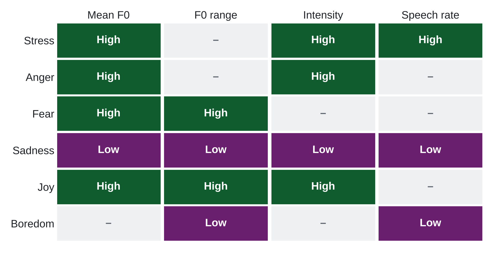

Four short exercises carry you from listening to a research design. Exercises 1–3 run in the [lab notebook](lab/voice_lab.html), where each has a prepared `YOUR TURN` chunk and a folded solution. Exercise 4 needs only a pen.

## Warm-up · Audacity (10′, demo)

```{=html}
<div class="exercise">
<div class="meta">10 minutes · follow along or watch</div>
<ol>
<li><b>Open & compare:</b> drag <code>data/1_alexa/alexa_cmd1.wav</code> and <code>alexa_cmd2.wav</code> into one project. Compare length, pauses and peaks.</li>
<li><b>Spectrogram view:</b> track menu (the track name) → <i>Spectrogram</i>. Watch the harmonics rise in the frustrated command.</li>
<li><b>Plot a spectrum:</b> select one vowel → <i>Analyze → Plot Spectrum</i>. Find F0 and the formants.</li>
<li><b>Edit, then re-check:</b> <i>Truncate Silence</i>, and change pitch by ±2 semitones. What changes in what you hear, and in the picture?</li>
<li><b>Hear the microphone:</b> load all files in <code>data/2_micTests/</code>. Same speaker, seven devices: which ones roll off the highs?</li>
</ol>
</div>
```

## Exercise 1 · Listen & look

```{=html}
<div class="exercise">
<div class="meta">8 minutes · pairs · notebook block 2</div>
<ol>
<li>Pick an actor (02, 03 or 04). Plot calm vs. angry oscillograms and spectrograms side by side.</li>
<li>Now <code>bind()</code> the two clips and plot them on one shared scale. What appears that was hidden?</li>
<li>Run <code>timer()</code> with threshold 5 and 10. Which onset matches what you hear?</li>
</ol>
<div class="deliv"><b>Deliverable</b> · One sentence naming the cue that gives anger away first, and the onset threshold you would use.</div>
</div>
```

## Exercise 2 · Feature extraction

```{=html}
<div class="exercise">
<div class="meta">12 minutes · individual → pairs · notebook block 4</div>
<ol>
<li>Run <code>voiceR::autoExtract()</code> on the 32 trimmed clips.</li>
<li>Plot <code>pitch_mean</code>, <code>pitch_sd</code>, <code>loudness_mean</code> and <code>HNR_mean</code> by emotion, then add one spectral and one temporal feature of your choice.</li>
<li>Compare with the emotion-signature table from the slides, and check whether the effect holds for every actor.</li>
</ol>
<div class="deliv"><b>Deliverable</b> · The feature family that separates calm from angry best, and one feature that surprised you.</div>
</div>
```

{width=70%}

## Exercise 3 · Prediction

```{=html}
<div class="exercise">
<div class="meta">10 minutes · pairs · notebook block 5</div>
<ol>
<li>Fit a lasso on all 192 clips, holding out whole actors. Re-run with a different seed: how stable is the AUC?</li>
<li>Compute AUC for female vs. male and for normal vs. strong intensity.</li>
<li>Name the first thing that would break if you used this model on customer-service calls.</li>
</ol>
<div class="deliv"><b>Deliverable</b> · Your AUC, the weakest subgroup, and one validity threat for field use.</div>
</div>
```

## Exercise 4 · Idea sprint

```{=html}
<div class="exercise">
<div class="meta">15 minutes · pairs → room</div>
<ol>
<li>Pick one project of yours. Where could voice be the <b>IV</b> (manipulate a vocal cue), the <b>DV</b> (measure the voice) or the <b>mediator</b>?</li>
<li>Name the construct, the feature family that should move, and in which direction.</li>
<li>Name your data source (lab, online, field, voice agent) and the biggest validity threat.</li>
</ol>
<div class="deliv"><b>Deliverable</b> · A one-sentence pitch: “We will measure ___ in voice to show ___.” Two or three pairs share.</div>
</div>
```
