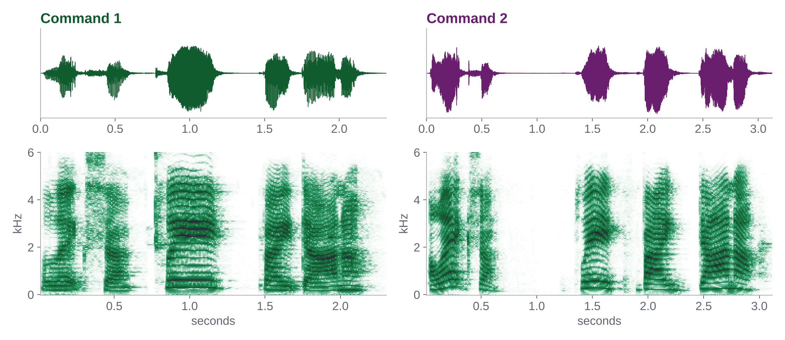

```{=html}
<style>#title-block-header{display:none}</style>
<div class="hero" style="background-image: linear-gradient(rgba(106,31,110,.82), rgba(106,31,110,.82)), url('assets/hero.jpg');">
  <div class="kicker">Guest workshop · University of Melbourne</div>
  <h1>Listening to Behavior</h1>
  <p class="lead">Voice analytics for behavioural scientists: from acoustic features to voice agents, in one afternoon.</p>
  <p><a class="btn-hsg" href="setup.html">Set up before you come</a>
     <a class="btn-hsg" style="background:#fff;color:#6A1F6E !important" href="lab/voice_lab.html">Open the lab notebook</a></p>
</div>

<div class="facts">
  <div class="fact"><div class="k">When</div><div class="v">Wed 11 Nov 2026<br>13:00–15:30</div></div>
  <div class="fact"><div class="k">Format</div><div class="v">Theory + hands-on lab</div></div>
  <div class="fact"><div class="k">Audience</div><div class="v">PhD students, postdocs, faculty</div></div>
  <div class="fact"><div class="k">Bring</div><div class="v">Laptop + headphones</div></div>
  <div class="fact"><div class="k">Facilitator</div><div class="v">Prof. Christian Hildebrand, HSG</div></div>
</div>
```

## About the workshop

The human voice carries what surveys and clicks miss: emotion in real time, arousal and stress, confidence, and spontaneous reactions before conscious reflection. Smart speakers, voice assistants and LLM-based voice agents now make voice data cheap to collect at scale, yet most behavioural researchers lack the tools to use it.

This condensed workshop introduces voice as a behavioural data layer. We cover how speech is produced, which acoustic features map onto which psychological states, and where construct validity breaks down. In the hands-on lab you work with real emotional speech (calm vs. angry speakers): you listen in Audacity, plot waveforms and spectrograms in R, extract acoustic features with **voiceR**, and test whether those features separate the two states. We close with voice-based conversational agents for data collection, the ethics of voice data, and a short sprint on your own research ideas. No prior voice analytics experience is needed.



## Agenda

```{=html}
<table class="agenda">
<tr><td>13:00</td><td><span class="tag lec">Lecture</span><b>Welcome & why voice</b>: voice as a behavioural data layer; live demo with two Alexa commands</td></tr>
<tr><td>13:15</td><td><span class="tag lec">Lecture</span><b>Theory & measurement</b>: speech chain and source–filter model; feature families; emotion signatures; construct validity and recording devices</td></tr>
<tr><td>13:55</td><td><span class="tag brk">Break</span>Open the lab notebook and test your audio</td></tr>
<tr><td>14:05</td><td><span class="tag demo">Demo</span><b>Audacity warm-up</b>: waveforms, spectrogram view, spectra, silence and pitch edits, seven microphones</td></tr>
<tr><td>14:15</td><td><span class="tag lab">Lab</span><b>Hands-on case: calm vs. angry</b> (RAVDESS) in R: listen and look, trim, extract with voiceR, compare, predict (Exercises 1–3)</td></tr>
<tr><td>14:55</td><td><span class="tag lec">Lecture</span><b>From analytics to voice agents</b>: speech-to-text, the STT → LLM → TTS loop, consent, privacy and bias</td></tr>
<tr><td>15:15</td><td><span class="tag spr">Sprint</span><b>Idea sprint & wrap-up</b> (Exercise 4): voice as IV, DV or mediator in your own research</td></tr>
</table>
```

## Learning outcomes

```{=html}
<div class="cards">
 <div class="card-x"><div class="k">01</div><h4>Argue for voice</h4>Explain why voice is a distinct behavioural data source and where it adds value over text and self-report.</div>
 <div class="card-x"><div class="k">02</div><h4>Map features to constructs</h4>Link pitch, loudness, spectral, voice-quality and timing features to psychological states, and name the main validity threats.</div>
 <div class="card-x"><div class="k">03</div><h4>Run a minimal pipeline</h4>Load audio, plot waveforms and spectrograms, trim, extract features and compare conditions in R.</div>
 <div class="card-x"><div class="k">04</div><h4>Design with voice</h4>Sketch how voice enters your own studies as IV, DV or mediator, including via voice agents.</div>
</div>
```

## Facilitator

**Christian Hildebrand** is Full Professor of Marketing Analytics and Vice Dean at the University of St.Gallen (HSG), Executive Director of the Institute of Behavioral Science & Technology, and Visiting Professor at CUHK. His research examines consumer behaviour in interactions with AI, with a focus on voice, conversational agents and new behavioural methods. Contact: [christian.hildebrand@unisg.ch](mailto:christian.hildebrand@unisg.ch)

*This is the one-afternoon version of the 5-day GSERM course “Voice Analytics for Behavioral Scientists”.*
