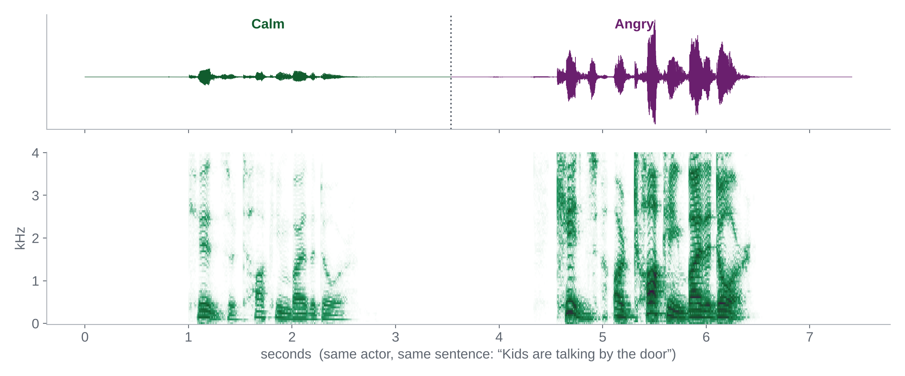

## Slides

<a class="btn-hsg" href="slides/Melbourne_SpeechAnalytics2026_Slides.pdf">Slides (PDF)</a>

| Part | Content |
|---|---|
| 1 · Why voice? | Motivation; self-report vs. voice analytics; what voice can tell us; live demos; three ways to think about voice |
| 2 · Theory & measurement | Theory foundations; speech chain; four feature families; emotion signatures; theory → measurement; terminology; recording devices and guidelines; validity threats |
| 3 · Hands-on lab | Audacity warm-up; why R; the voice analytics pipeline; voiceR; lab roadmap; Exercises 1–3; debrief |
| 4 · Extension: voice agents | Speech-to-text; anatomy of a voice agent; consent, privacy and bias; idea sprint (Exercise 4) |

## Lab notebook

<a class="btn-hsg" href="lab/voice_lab.html">Rendered notebook (with solutions)</a>
<a class="btn-hsg alt" href="https://github.com/childebrand/Melbourne-Voice-2026/blob/main/lab/voice_lab.qmd">Source (.qmd)</a>

## Audio and data

<a class="btn-hsg" href="https://github.com/childebrand/Melbourne-Voice-2026/archive/refs/heads/main.zip">Download all materials (.zip)</a>

| Dataset | Files | Used for |
|---|---|---|
| **Alexa interaction** | `alexa_cmd1.wav`, `alexa_cmd2.wav`, `alexa_wakeword_1–3.wav` | Live demo, Audacity warm-up, notebook block 1 |
| **Microphone tests** | 7 devices (Bose, Elgato, Rode NT1, Sennheiser, Rode Wireless GO, Rode SmartLav, MacBook) + 2 breathing samples | Audacity warm-up, notebook bonus |
| **RAVDESS calm vs. angry** | 32 clips (actors 01–04) + features and embeddings for all 192 clips | Exercises 1–3 |

RAVDESS: Livingstone & Russo (2018), [*PLoS ONE*](https://doi.org/10.1371/journal.pone.0196391); data at [zenodo.org/records/1188976](https://doi.org/10.5281/zenodo.1188976), licensed CC BY-NC-SA 4.0. The subset here is redistributed for non-commercial teaching under the same licence.
